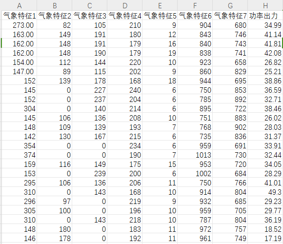
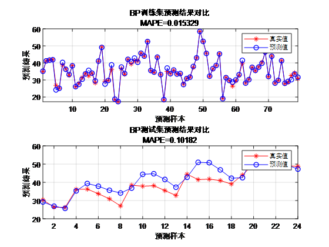
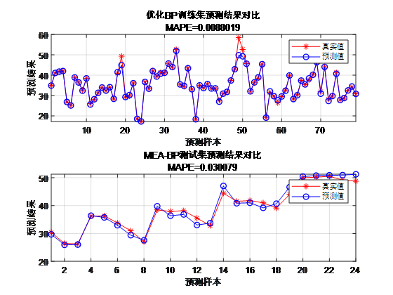

# MEA-BP regression prediction Matlab program, optimization of BP neural network for regression prediction using the Thinking Evolution Method.

Applicable Platform: MATLAB 2021 and above
Suitable for wind speed prediction, photovoltaic power prediction, power generation forecasting, offshore wind power forecasting, carbon price forecasting, etc.
Data Format: Use seven meteorological features to predict power output.
Prediction Results: Traditional BP
MEA-BP Prediction Results:

## Images

<!-- PAYMENT_BLOCK -->

## Get this dataset

- Payment link (Stripe): [Buy now](https://buy.stripe.com/3cs8yP7sY87d0vu9AB)
- Payment QR code: 

<!-- /PAYMENT_BLOCK -->
